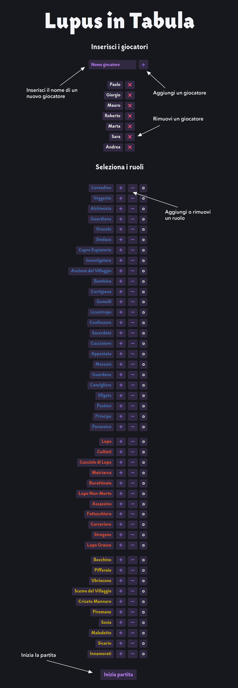

# Lupus Helper
Un semplice helper per aiutare il narratore a gestire partite di Lupus in Tabula con più facilità.
Non è pensato per sostituire il gioco cartaceo ma aiutare a gestirlo, inoltre non usa i ruoli standard di Lupus ma una semplice variante che utilizzo di solito con i miei amici, a seguire troverete una tabella con tutti i ruolo presenti in questo tool e le rispettive regole.
È composto da solo due semplici schermate: 
1) la prima schermata permette di impostare i nomi dei partecipanti e selezionare quali ruoli si vogliono utilizzare. Nomi e ruoli selezionati vengono salvati nel browser e ripristinati per le partite successive.

2) la seconda è la schermata di gioco con semplici funzioni che permettono al narratore di tenere traccia di poteri, uccisioni...

Carte Ruoli -> [Premi qui per scaricare le carte da stampare](https://drive.google.com/file/d/1Otb2JT-po8P2vSA9q9oxV-nDykezjb_W/view?usp=sharing)

Regole Ruoli -> [Premi qui per vedere le regole di ogni ruolo](https://docs.google.com/document/d/14FWfCJR8JljtEdLg39nSgWKPbp_zUiMSxppwzCfbhAw/edit?usp=sharing)

Sito -> [Premi qui per andare al sito](https://werewolfgamehelper.altervista.org)
