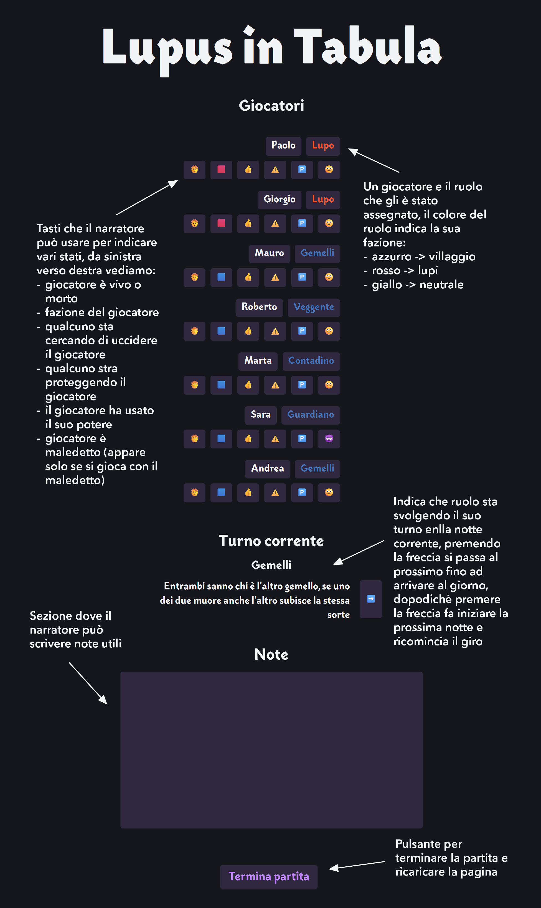

# Lupus Helper
Un semplice helper per aiutare il narratore a gestire partite di Lupus in Tabula con più facilità.
Non è pensato per i ruoli standard di Lupus ma una semplice variante che utilizzo di solito con i miei amici, a seguire troverete una tabella con tutti i ruolo presenti in questo tool e le rispettive regole.
È composto da solo due semplici schermate: 
1) la prima schermata permette di impostare i nomi dei partecipanti e selezionare quali ruoli si vogliono utilizzare

2) la seconda è la schermata di gioco con semplici funzioni che permettono al narratore di tenere traccia di poteri, uccisioni...

Ruoli
| Ruolo  | Potere | Info |
|------- | ------ | ---- |
| VILLAGGIO | | |
| Contadino | Ruolo di base della squadra del villaggio | |
| Veggente | Ogni notte puoi scoprire se un giocatore appartiene alla squadra dei lupi o no | Riceve solo risposte sì/no, non scopre effettivamente il ruolo del giocatore ispezionato, I giocatori neutrali non appaiono come lupi, Solitamente si sveglia prima dei personaggi con poteri di cambiare fazione ma dopo quelli con potere di alterare le apparenze |
| Alchimista | Ogni notte ti svegli dopo i lupi e scopri chi hanno scelto di uccidere. Hai due pozioni, una per salvare e una per uccidere, puoi usarle entrambe solo una volta per partita e non per forza nella stessa notte | Dopo aver usato la pozione per salvare non scopri più chi hanno scelto di uccidere i lupi di notte, Si può optare di fargli usare una sola pozione, a sua scelta quale |
| Guardiano | Ogni notte puoi scegliere un giocatore da proteggere per quella notte | Non puoi proteggere te stesso e nemmeno la stessa persona due notti di fila, Puoi scegliere di non usare il potere |
| Oracolo | Ogni notte puoi ricevere indizi dai giocatori morti, ma possono solo indicare | Da usare senza role-reveal |
| Sindaco | La prima volta che vieni linciato, puoi rivelare il tuo ruolo e salvarti, da quel momento il tuo voto per il linciaggio vale doppio e in caso di parità scegli tu chi viene linciato |  |
| Capro espiatorio | Durante il linciaggio puoi sacrificarti per salvare il giocatore che stava per essere eliminato ed essere linciato al suo posto | Se c’è il role-reveal, il capro espiatorio dovrà dichiarare di voler usare il suo potere prima che l’altra persona riveli il suo ruolo |
| Investigatore | Ogni notte scegli due giocatori escluso te stesso per scoprire se appartengono alla stessa squadra | Se uno o entrambi i bersagli sono neutrali, il risultato è sempre squadre diverse, Non può scegliere giocatori che hanno rivelato la propria carta |
| Anziano del Villaggio | Non può essere ucciso dai lupi ma muore automaticamente dopo alcune notti a discrezione del narratore | Il numero della notte in cui muore solitamente è pari circa al numero di lupi |
| Bambina | Di notte quando i lupi si svegliano puoi cercare di spiare ma se vieni scoperta muori in aggiunta al giocatore scelto dai lupi |  |
| Cortigiana | Ogni notte puoi scegliere un giocatore, quel giocatore è immune a qualsiasi potere per quella notte, se muori però, anche il giocatore scelto morirà con te | - Anche scegliendo un giocatore appartenente alla squadra dei lupi, esso sarà immune agli altri poteri - Puoi scegliere di non usare il potere e non puoi usarlo su te stesso |
| Gemelli | Entrambi sanno chi è l'altro gemello, se uno dei due muore anche l'altro subisce la stessa sorte | Anche i poteri, come quello della matriarca si applicano ad entrambi, Se il veggente sceglie di ispezionare un gemello, scopre anche chi è l’altro |
| Licantropo | Fai parte della squadra del villaggio ma la prima volta che vieni ucciso dai lupi ti unisci alla loro squadra al posto di morire |  |
| Confessore | Una volta per partita, di notte, scegli un giocatore, il giocatore scelto dopo essersi svegliato dovrà mostrare la sua carta ad un altro giocatore a sua scelta |  |
| Sacerdote | Ogni notte se uno o più giocatori sono stati uccisi la notte precedente, puoi guardare il ruolo di uno di essi | Da usare senza role-reveal - Se muoiono più giocatori ne vede solo uno |
| Cacciatore | Quando muori, durante il linciaggio o ucciso dai lupi, scegli un altro giocatore da uccidere immediatamente |  |
| Appestato | Quando vieni ucciso dai lupi, la notte seguente non potranno uccidere nessuno, in modo simile se vieni linciato, il giorno dopo non ci sarà un linciaggio | Se si gioca senza role reveal, i lupi sceglieranno comunque la vittima ma non morirà veramente |
| Massoni | I massoni sanno chi sono gli altri massoni, nessun giocatore può parlare direttamente o indirettamente dei massoni, chi lo fa verrà ucciso quella notte dalla società segreta, I massoni si svegliano ogni notte per ultimi e vengono informati di quale giocatore ha usato un potere su uno di loro, non sanno né di che potere si tratta né su che membro del gruppo, Se più persone usano i loro poteri su un massone, tutte verranno indicate dal narratore |
| Guardone | Ogni notte scegli un giocatore e se si sveglia di notte, ti svegli insieme a lui, se appartiene alla squadra dei lupi, tu muori |  |
| Consigliere | Ogni notte puoi scegliere un giocatore a parte te stesso e decidere il voto di quel giocatore varrà doppio o sarà nullo per quel giorno |  |
| Sfigato | Appari nella squadra dei lupi se ispezionato ma appartieni alla squadra del villaggio |  |
| Postino | Durante la prima notte, ti svegli e puoi scegliere uno dei tuoi due vicini di posto e rivelargli la tua carta |  |
| Principe | Se verresti ucciso di notte, l'attacco viene invece deviato su uno dei tuoi due vicini di posto originali | La nuova vittima viene scelta casualmente dal narratore, Funziona solo se i vicini fanno parte della squadra del villaggio |
| Paranoico | Ogni notte sai se ci sono dei giocatori della squadra dei lupi nelle tue vicinanze | Il narratore ti comunicherà “vicino”, “medio” o “lontano” in base alla posizione del lupo più vicino a te |
| LUPI |  |  |
| Lupo | Ruolo di base della squadra dei lupi, di notte si svegliano tutti insieme e decidono chi uccidere | Tutti i lupi speciali si svegliano insieme ai lupi normali per decidere chi uccidere |
| Cultisti | Sai chi sono i lupi e vinci con loro ma i lupi non sanno chi sono i cultisti, non ti svegli insieme ai lupi per uccidere, Appaiono come buoni se ispezionati ma sono nella squadra dei lupi |  |
| Cucciolo di Lupo | Se vieni eliminato, la notte successiva i lupi potranno eliminare due giocatori |  |
| Matriarca | Una sola volta per partita, scegli se il giocatore ucciso dai lupi, al posto di morire, si trasformerà in un lupo, anche se difeso | Non funziona sui giocatori della squadra neutrale |
| Burattinaio | Se durante il linciaggio voti per il giocatore con il maggior numero di voti, verrà invece ucciso il giocatore al secondo posto |  |
| Lupo non-morto | Puoi segretamente votare per il linciaggio durante il giorno anche da morto | Da usare senza role-reveal |
| Assassino | Non ti svegli coi lupi e appari come buono se ispezionato. Ogni notte puoi decidere se svegliarti con i lupi, se lo fai d’ora in poi dovrai svegliarti sempre con loro e perdi l’abilità di apparire come buono se ispezionato | Ti svegli sempre prima dei lupi per decidere, Non sai chi sono ma loro sanno chi sei, Se rimane come ultimo lupo si sveglia automaticamente |
| Fattucchiera | Ogni notte scegli un giocatore, se il suo ruolo viene ispezionato, apparirà della squadra opposta per quel turno |  |
| Carceriere | Ogni due notti scegli un giocatore che non potrà svegliarsi quel giorno | Quel giocatore non potrà votare e fornire informazioni per quel giorno, Puoi scegliere altri lupi |
| Stregone | Una volta per partita puoi scambiare il ruolo di due giocatori, se uno dei due era un lupo, dopo aver ricevuto il nuovo ruolo, muore |  |
| Lupo Grasso | Finché sei vivo i due giocatori vicini a te appariranno nella squadra dei lupi se esaminati |  |
| NEUTRALI |  |  |
| Becchino | Una sola volta per partita, quando un giocatore muore di notte, puoi scambiare il tuo ruolo con il suo, da adesso in poi avrai il suo potere e farai parte di quella squadra | Quando ti svegli ti viene comunicato solo chi è morto, scegli quindi se usare il potere prima di vedere il suo ruolo |
| Pifferaio | Ogni notte i giocatori incantati si svegliano insieme al pifferaio e scelgono che giocatore incantare, se tutti i giocatori vivi sono incantati vincono | Se muore il pifferaio tutti i giocatori smettono di essere incantati, I ruoli che si svegliano in gruppo come lupi e massoni, se incantati non si svegliano più con il loro gruppo originale, I giocatori incantati non possono votare per linciare il pifferaio |
| Ubriacone | Scopri il tuo ruolo solo dopo alcuni turni a discrezione del narratore | Necessita di essere giocato con una carta extra rispetto al numero di giocatori, Solitamente riceve il ruolo circa alla terza notte |
| Scemo del Villaggio | Vinci se riesci a farti linciare dal villaggio |  |
| Criceto Mannaro | Ti svegli insieme ai lupi ma non sanno che sei il criceto, ti svegli di nuovo dopo di loro e puoi uccidere un altro giocatore (anche lupi), non sei immune all'eliminazione dei lupi, se resti l'unico vivo vinci | Si può optare di fargli uccidere a notti alterne |
| Piromane | A inizio partita i giocatori vengono divisi in due secondo un criterio deciso dal narratore (altezza, colore capelli, sesso...), vinci se tutti i giocatori del gruppo a cui non appartieni muoiono | Il criterio deve essere noto a tutti |
| Sosia | A inizio partita scegli uno dei giocatori seduti vicino a te, d'ora in poi vinci con lui, se muore, anche tu muori | Anche se il giocatore scelto è nella squadra dei lupi, tu non appari come lupo se ispezionato, Il giocatore scelto non sà nulla, Non sai a che fazione appartiene il giocatore scelto |
| Maledetto | Ogni notte scegli un giocatore e dagli questa carta, a fine partita chi ha il ruolo del maledetto perde | Necessita di essere giocato con una carta extra rispetto al numero di giocatori, un giocatore casuale riceverà questa carta in aggiunta al suo ruolo standard - Poteri che ispezionano i ruoli, vedranno il maledetto sempre come neutrale a prescindere dal suo ruolo standard, Poteri che scambiano o modificano i ruoli invece agiranno su quello standard e non sul maledetto |
| Sicario | Se verresti ucciso di notte, uccidi invece una persona casuale scelta dal narratore appartenente alla squadra opposta di quella che ti avrebbe ucciso. Se a fine partita è ancora vivo, vince al posto della squadra che avrebbe vinto normalmente | Puoi essere ucciso solo di giorno tramite poteri come quello del cacciatore o linciato, Se verresti ucciso da un ruolo neutrale, non muore nessuno al tuo posto |
| Innamorati | Se alla fine del giorno sono seduti vicini, vincono. Se uno muore anche l’altro muore | Il narratore dovrebbe darli a due giocatori lontani a inizio partita, A inizio partita scoprono chi è l’altro |
